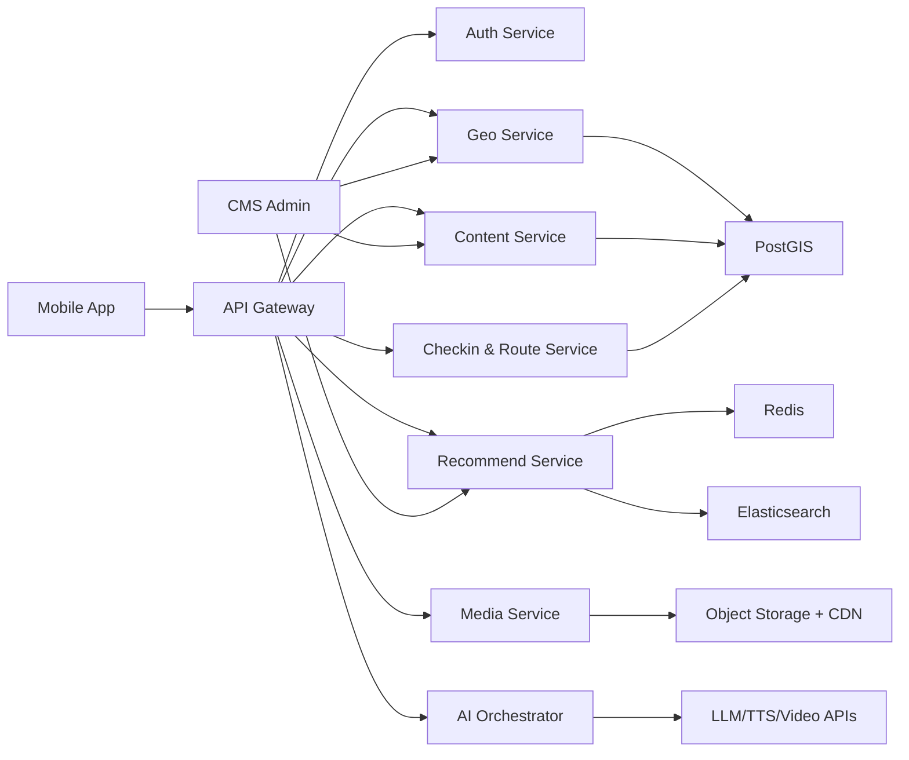

# 觅诗系统架构设计（v1）

目标：基于现有产品设计，形成可落地的四层架构：业务架构、数据架构、应用架构、技术架构。

## 1. 业务架构（Business Architecture）

### 1.1 业务目标
- 到地触发：用户到达相关地点后主动推送诗词
- 场景匹配：结合季节/节气提高推荐贴合度
- 沉浸体验：权威解读 + 语音朗读 + 可选 AI 动画
- 旅行打卡：地点+诗词打卡与路线成就体系

### 1.2 业务能力地图
- `C1 地理感知能力`：定位、围栏命中、古今地名映射
- `C2 内容供给能力`：诗词、背景、人物、权威解读管理
- `C3 智能推荐能力`：距离/热度/季节/时段联合排序
- `C4 沉浸媒体能力`：朗读音频、动画生成、媒体分发
- `C5 旅行打卡能力`：打卡记录、路线编排、成就进度
- `C6 运营与治理能力`：内容审核、策略配置、数据分析

### 1.3 核心业务流程
1. 定位与到地：用户位置 -> 围栏命中 -> 古今地名置信匹配
2. 推荐与消费：推荐卡（含季节标签）-> 详情阅读 -> 朗读/动画
3. 打卡与路线：一键打卡 -> 生成打卡卡片 -> 路线进度更新 -> 分享
4. 运营闭环：行为埋点 -> 分析看板 -> 推荐策略与内容优化

---

## 2. 数据架构（Data Architecture）

### 2.1 数据域划分
- `内容域`：poems, poets, interpretations, stories, references
- `地理域`：poi, geofence, historical_name_mapping, place_season_profile
- `推荐域`：recommend_features, feature_weights, recommend_logs
- `用户域`：users, preferences, favorites, footprints
- `打卡域`：checkin_records, checkin_cards, route_templates, route_progress
- `媒体域`：media_assets, playback_events, video_jobs, ai_jobs
- `治理域`：audit_logs, moderation_records, publish_versions

### 2.2 核心主数据与关系
- 诗词（Poem）与地点（POI）是双核心主数据
- POI 通过 `historical_name_mapping` 关联古今地名
- Poem 通过 `best_season/solar_terms` 关联季节标签
- 用户打卡记录关联 `user_id + poem_id + poi_id + occurred_at`
- 路线模板由城市维度管理，进度由用户实例化

### 2.3 存储选型
- `PostgreSQL + PostGIS`：事务数据、空间计算、围栏查询
- `Elasticsearch`：诗词全文检索、古今地名别名检索
- `Redis`：热点推荐缓存、打卡幂等键、会话缓存
- `Object Storage + CDN`：音频/视频资产
- `OLAP/数仓`（后续）：行为分析、推荐效果评估

### 2.4 数据质量与治理
- 内容双审：录入 -> 一审 -> 二审 -> 发布
- 来源必填：来源、版本、发布时间、版权状态
- 打卡幂等：`user_id + poi_id + time_bucket` 去重
- 数据分级：定位与行为数据按敏感级别脱敏/留存管控

---

## 3. 应用架构（Application Architecture）

### 3.1 分层与服务
- `Client Layer`：iOS/Android App
- `Access Layer`：API Gateway + Auth
- `Domain Services`：
  - Content Service
  - Geo Service
  - Recommend Service
  - Checkin & Route Service
  - Media Service
  - AI Orchestrator
- `Admin Layer`：CMS Admin + Ops Console

### 3.2 服务协作图

### 3.3 关键接口边界
- 地理：`/geo/nearby`
- 推荐：`/poems/recommend`
- 详情：`/poems/{poem_id}`
- 打卡：`/checkins`
- 路线：`/routes/{city_code}`
- 媒体：`/audio/{poem_id}`
- AI：`/video/jobs`、`/video/jobs/{job_id}`

### 3.4 关键应用模式
- 同步读：推荐、详情、音频地址
- 异步任务：动画生成、转码、回调通知
- 事件驱动：打卡完成、播放完成、分享行为上报

---

## 4. 技术架构（Technology Architecture）

### 4.1 技术栈
- 客户端：Flutter（或 React Native）
- 服务端：Go/Java（REST/gRPC）
- 数据：PostgreSQL + PostGIS、Redis、Elasticsearch
- 基础设施：Kubernetes、Ingress、CDN、对象存储
- 可观测：OpenTelemetry、Prometheus、Grafana、ELK/Loki
- CI/CD：GitHub Actions/Jenkins + 灰度发布

### 4.2 部署架构
- dev：低配单区，快速联调
- staging：生产镜像拓扑，回归与压测
- prod：多可用区，核心服务 HPA 扩缩容
- 发布策略：5% -> 20% -> 50% -> 100% 金丝雀

### 4.3 技术关键设计
- 高可用：核心服务多副本 + 跨 AZ
- 性能：推荐缓存、地理索引、连接池与读写分离
- 安全：JWT、最小权限、敏感数据脱敏、审计日志
- 成本：AI 任务限额、超时熔断、结果缓存复用

### 4.4 NFR 指标映射
- 接口性能：P95 < 300ms（不含视频生成）
- 稳定性：可用性 >= 99.9%，客户端崩溃率 < 0.5%
- 业务：季节推荐点击率 >= 30%，打卡转化率 >= 20%

---

## 5. 演进路线（建议）
- `阶段 A（MVP）`：模块化单体 + 明确域边界
- `阶段 B（增长）`：拆分推荐/媒体/AI 为独立服务
- `阶段 C（规模化）`：引入特征平台与实时推荐、路线智能规划

## 6. 关键风险与架构应对
- 地名误匹配：置信度阈值 + 二次确认 + 人工纠错台
- 季节推荐失真：规则可配置 + AB 实验 + 线上回收指标
- AI 成本波动：配额控制 + 模板化 Prompt + 缓存策略
- 打卡作弊：位置漂移校验 + 速度阈值 + 风险规则
